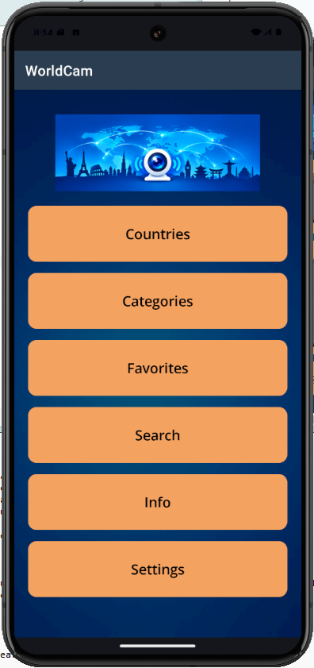
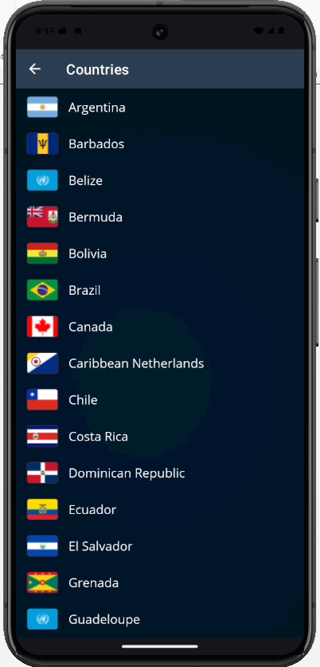
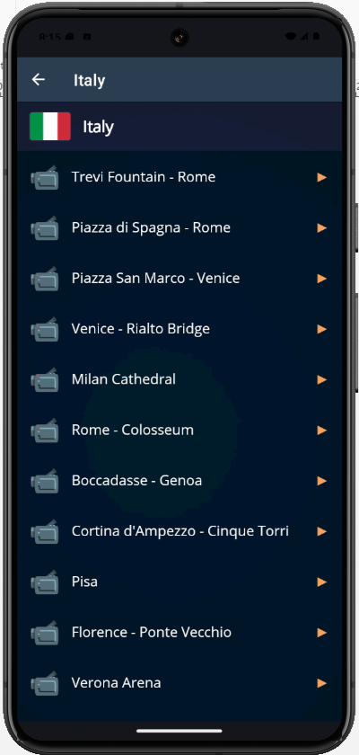
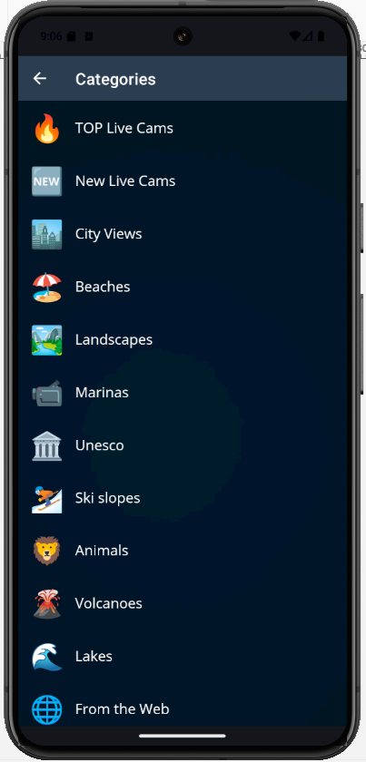
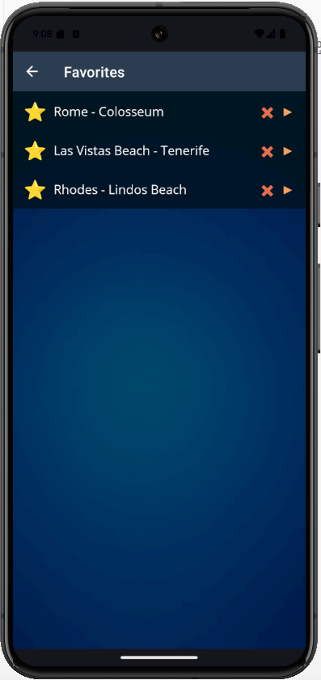
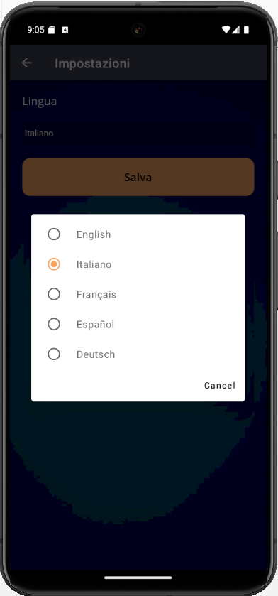
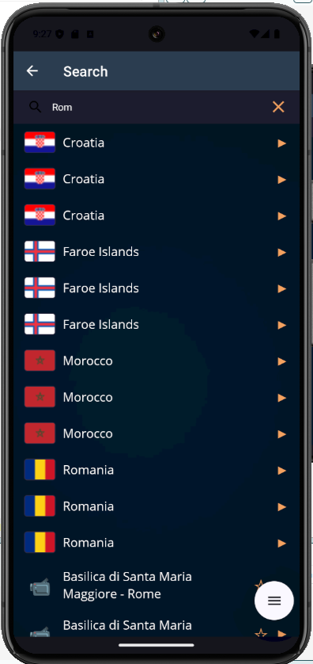
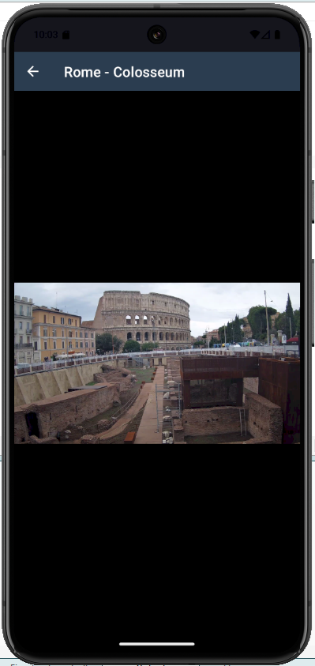
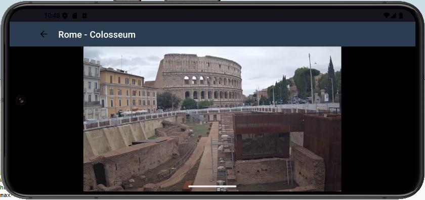
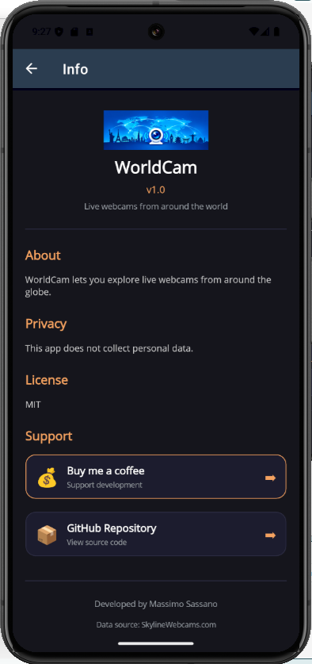

# WorldCam

🇮🇹 [Italiano](#-italiano) · 🇬🇧 [English](#-english)

---

## 🇮🇹 Italiano

App Android per esplorare **webcam live da tutto il mondo**.  

### ✨ Funzionalità

- 🌍 **Esplora per Paese** — oltre 80 paesi con bandiere ufficiali
- 🗂️ **Esplora per Categoria** — spiagge, città, montagne, porti, vulcani, animali e molte altre
- 🔥 **Top Webcam** — le webcam più popolari del momento
- 📍 **Navigazione gerarchica** — Paese → Regione/Città → Webcam
- 🖼️ **Anteprime (Thumbnail)** — immagini in tempo reale direttamente nella lista
- ▶️ **Player HLS integrato** — riproduzione fluida delle webcam live
- 📹 **Apertura YouTube** — se una webcam è su YouTube, si apre l'app YouTube di Android
- ⭐ **Preferiti** — salva le tue webcam preferite sul telefono
- 🔍 **Ricerca live** — cerca tra paesi e webcam mentre digiti
- 🌐 **Multi-lingua** — Italiano, Inglese, Francese, Spagnolo, Tedesco
- 🌙 **Tema scuro** — interfaccia ottimizzata per l'uso serale
- 📱 **Interfaccia semplice** — pulsanti grandi, ideale per tutti

### 📸 Screenshot

| Home | Paesi | Locations |
|:---:|:---:|:---:|
|  |  |  |

| Categorie | Preferiti | Impostazioni |
|:---:|:---:|:---:|
|  |  |  |

| Ricerca | Player |
|:---:|:---:|
|  |  |

| Player landscape |
|:---:|
|  |

| Info |
|:---:|
|  |

### 📥 Download

**Requisiti:**
- Android 7.0 (API 24) o superiore
- Connessione Internet

**Installazione:**
1. **Da Google Play:** Cerca **WorldCam** sul Play Store o clicca il badge qui sopra per scaricare e installare automaticamente.
2. **Da GitHub:** Scarica l'ultima `WorldCam.apk` dalla sezione [Releases](https://github.com/maxsassano/worldcam/releases), abilita le *Origini sconosciute* e installa.

**Aggiornamento su Google Play:**
- **Automatico:** Se hai attivato gli aggiornamenti automatici sul Play Store, l'app si aggiornerà da sola in background.
- **Manuale:** Apri il Google Play Store → tocca la tua foto profilo → *Gestisci app e dispositivo* → *Aggiornamenti disponibili* → tocca *Aggiorna* accanto a WorldCam.

### 🕹️ Come si usa

**Prima apertura**  
All'avvio vedrai la **Home** con i pulsanti principali: *Paesi, Categorie, Preferiti, Cerca, Top Webcam, Info, Impostazioni*.

**Navigazione**  
1. **Paesi** → seleziona un paese (es. Italia)  
2. **Regioni/Città** → seleziona una regione (es. Lombardia)  
3. **Webcam** → tocca una webcam per aprire il player  
4. **Player** → la webcam live parte automaticamente  

**Preferiti**  
- Tocca la **☆** per aggiungere una webcam ai preferiti  
- La stella diventa **★** e la webcam compare in *Preferiti*  
- Tocca **✖** per rimuoverla  

**Ricerca**  
- Tocca **Cerca** e digita il nome di un paese o di una webcam  
- I risultati appaiono in tempo reale  

**Cambio lingua**  
- **Impostazioni** → seleziona la lingua → **Salva**  
- L'interfaccia cambia immediatamente, senza riavvio  

### 🛠️ Tecnologie

| Componente | Tecnologia |
|------------|-----------|
| Framework | .NET MAUI 10 |
| Linguaggio | C# 13 |
| UI | XAML |
| Player HLS | hls.js (via WebView) |
| Bandiere | flagcdn.com |
| Dati webcam | SkylineWebcams.com |

### 📄 Licenza

Questo progetto è distribuito con licenza **MIT**.  
Vedi il file [LICENSE](LICENSE) per i dettagli.

### ☕ Sostieni il progetto

Se l'app ti è utile, puoi offrirmi un caffè:

### 👤 Autore

**Massimo Sassano**
- GitHub: [@maxsassano](https://github.com/maxsassano)
- Repository: [github.com/maxsassano/worldcam](https://github.com/maxsassano/worldcam)

---

## 🇬🇧 English

Android app to explore **live webcams from around the world**.  

### ✨ Features

- 🌍 **Browse by Country** — over 80 countries with official flags
- 🗂️ **Browse by Category** — beaches, cities, mountains, ports, volcanoes, animals and more
- 🔥 **Top Webcams** — the most popular webcams right now
- 📍 **Hierarchical navigation** — Country → Region/City → Webcam
- 🖼️ **Thumbnails** — live preview images directly in the list
- ▶️ **Built-in HLS player** — smooth playback of live webcams
- 📹 **YouTube opening** — if a webcam is on YouTube, the Android YouTube app opens
- ⭐ **Favorites** — save your favorite webcams on your phone
- 🔍 **Live search** — search countries and webcams as you type
- 🌐 **Multi-language** — English, Italian, French, Spanish, German
- 🌙 **Dark theme** — optimized for evening use
- 📱 **Simple interface** — large buttons, suitable for everyone

### 📥 Download

**Requirements:**
- Android 7.0 (API 24) or higher
- Internet connection

**Installation:**
1. **From Google Play:** Search for **WorldCam** on the Play Store or click the badge above to download and install automatically.
2. **From GitHub:** Download the latest `WorldCam.apk` from the [Releases](https://github.com/maxsassano/worldcam/releases) page, enable *Unknown sources*, and install.

**Updating via Google Play:**
- **Automatic:** If auto-update is enabled on the Play Store, the app will update itself in the background.
- **Manual:** Open Google Play Store → tap your profile picture → *Manage apps & device* → *Updates available* → tap *Update* next to WorldCam.

### 🕹️ How to use

**First launch**  
On startup you'll see the **Home** with the main buttons: *Countries, Categories, Favorites, Search, Top Webcams, Info, Settings*.

**Navigation**  
1. **Countries** → pick a country (e.g. Italy)  
2. **Regions/Cities** → pick a region (e.g. Lombardy)  
3. **Webcams** → tap a webcam to open the player  
4. **Player** → the live webcam starts automatically  

**Favorites**  
- Tap **☆** to add a webcam to your favorites  
- The star turns into **★** and the webcam appears in *Favorites*  
- Tap **✖** to remove it  

**Search**  
- Tap **Search** and type a country or webcam name  
- Results appear in real time  

**Language switch**  
- **Settings** → choose a language → **Save**  
- The UI changes instantly, no restart needed  

### 🛠️ Tech stack

| Component | Technology |
|------------|-----------|
| Framework | .NET MAUI 10 |
| Language | C# 13 |
| UI | XAML |
| HLS player | hls.js (via WebView) |
| Flags | flagcdn.com |
| Webcam data | SkylineWebcams.com |

### 📄 License

This project is released under the **MIT License**.  
See the [LICENSE](LICENSE) file for details.

### ❤️ Support development

👉 **[Buy me a coffee](https://paypal.me/veruscatanese)**

### 👤 Author

**Massimo Sassano**
- GitHub: [@maxsassano](https://github.com/maxsassano)
- Repository: [github.com/maxsassano/worldcam](https://github.com/maxsassano/worldcam)

---

*Ultimo aggiornamento / Last update: Novembre 2026*
